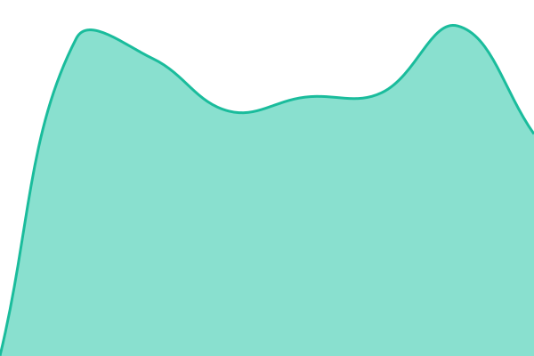
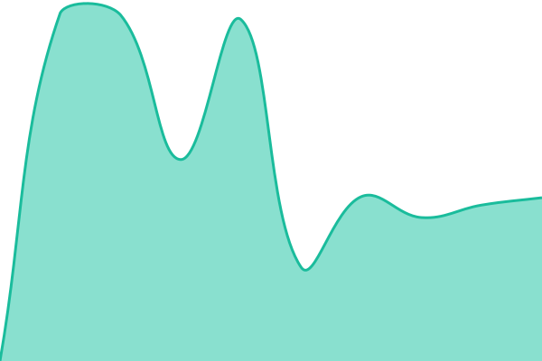
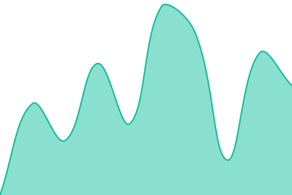

# [📈 Live Status](https://RegexNewbie.github.io/downtime): <!--live status--> **🟧 Partial outage**

This repository contains the open-source uptime monitor and status page for [Regex Newbie](https://RegexNewbie.github.io/downtime), powered by [Upptime](https://github.com/upptime/upptime).

With [Upptime](https://upptime.js.org), you can get your own unlimited and free uptime monitor and status page, powered entirely by a GitHub repository. We use [Issues](https://github.com/RegexNewbie/downtime/issues) as incident reports, [Actions](https://github.com/RegexNewbie/downtime/actions) as uptime monitors, and [Pages](https://RegexNewbie.github.io/downtime) for the status page.

<!--start: status pages-->
<!-- This summary is generated by Upptime (https://github.com/upptime/upptime) -->
<!-- Do not edit this manually, your changes will be overwritten -->
<!-- prettier-ignore -->
| URL | Status | History | Response Time | Uptime |
| --- | ------ | ------- | ------------- | ------ |
|  HP | 🟩 Up | [hp.yml](https://github.com/RegexNewbie/downtime/commits/HEAD/history/hp.yml) | 

 1127ms
     
 | 

<a href="https://RegexNewbie.github.io/downtime/history/hp">100.00%</a>
    

|  C CN HP | 🟥 Down | [c-cn-hp.yml](https://github.com/RegexNewbie/downtime/commits/HEAD/history/c-cn-hp.yml) | 

 2647ms
     
 | 

<a href="https://RegexNewbie.github.io/downtime/history/c-cn-hp">10.37%</a>
    

|  E1 CN HP | 🟩 Up | [e1-cn-hp.yml](https://github.com/RegexNewbie/downtime/commits/HEAD/history/e1-cn-hp.yml) | 

 6181ms
     
 | 

<a href="https://RegexNewbie.github.io/downtime/history/e1-cn-hp">100.00%</a>
    

<!--end: status pages-->

[**Visit our status website →**](https://RegexNewbie.github.io/downtime)

## 📄 License

- Powered by: [Upptime](https://github.com/upptime/upptime)
- Code: [MIT](./LICENSE) © [Anand Chowdhary](https://anandchowdhary.com)
- Data in the `./history` directory: [Open Database License](https://opendatacommons.org/licenses/odbl/1-0/)
